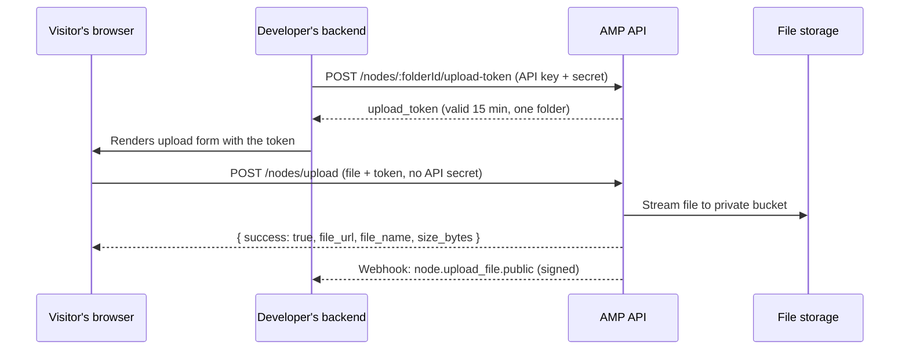
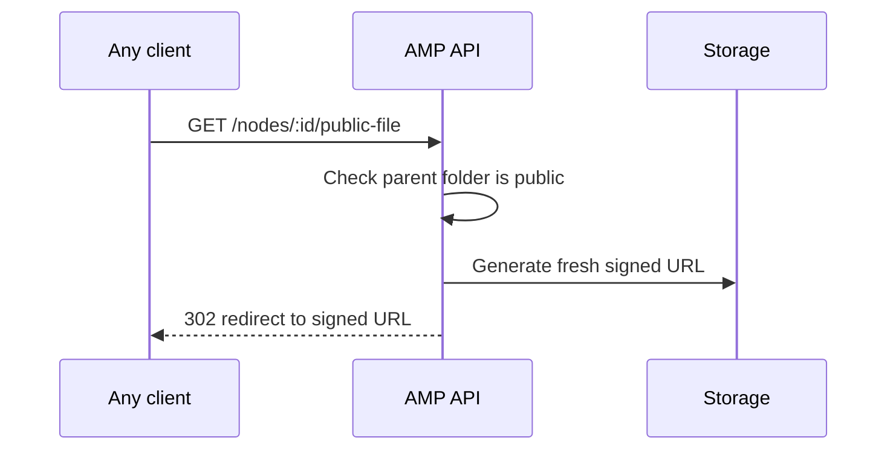

# AMP — Multi-Tenant File & Asset Management Platform

A multi-tenant file management platform where each organization gets its own isolated workspace: folders, files, team members, roles, branding, and developer integrations. Teams manage files through an admin dashboard, visitors can upload through secured public links, and developers can pull a curated, read-only view of selected files into their own websites through a scoped API.

> **Live demo:** _add link here_
> **API base URL:** _add link here_

---

## Table of Contents

- [Why this project](#why-this-project)
- [Core concepts](#core-concepts)
- [Features](#features)
- [How the main flows work](#how-the-main-flows-work)
- [Tech stack](#tech-stack)
- [Project structure](#project-structure)
- [Getting started](#getting-started)
- [Environment variables](#environment-variables)
- [API overview](#api-overview)
- [Security design](#security-design)
- [Design decisions & trade-offs](#design-decisions--trade-offs)
- [Roadmap](#roadmap)

---

## Why this project

Many products need to let an organization store files, share them with a team, accept uploads from outside visitors, and expose some of those files on a public website, without building that infrastructure from scratch. Examples include a university collecting student resumes, an agency exchanging files with clients, or a SaaS product that offers each customer a white-labeled document portal.

AMP covers that whole surface in one platform: private storage by default, explicit opt-in for anything public, role-based access control, and a full audit trail of who did what.

## Core concepts

| Concept | What it is |
|---|---|
| **Tenant** | An organization (for example "Acme University"). All data belongs to exactly one tenant, and tenants can never see each other's data. |
| **Tenant Role** | A reusable permission template defined per tenant (for example "Reviewer", "Admin"). Defines *what* a person can do. |
| **Tenant User** | A real person who belongs to one tenant and has one role. They sign in with Google. |
| **Node** | A single model for both folders and files, stored with an `ancestors` array for fast subtree reads. |

## Features

### Organization & access control
- **Multi-tenant isolation.** Every query is scoped by tenant, so there is no path for cross-tenant data access.
- **Google sign-in only.** No passwords to store or leak. Sign-in uses Google ID tokens verified server-side, then a session JWT.
- **Tenant bootstrap.** The first user creates the organization and becomes its Admin. Creation of the tenant, settings, Admin role, and first user runs inside a MongoDB transaction, so a mid-failure never leaves partial data.
- **Invite-based team onboarding.** Admins invite members by email with a role. The account activates automatically on first Google sign-in.
- **Role-based access control (RBAC).** Granular permissions: `node:read`, `node:create_folder`, `node:upload_file`, `node:edit`, `node:delete`, `user:manage`, `settings:manage`, `audit:read`.
- **Folder-subtree scoping.** A user can be limited to specific folders and everything beneath them, regardless of their role.
- **Role and user management.** Create, edit, and delete roles. Deleting a role un-assigns its users rather than deleting them. Edit a member's email or role at any time.

### Files & folders
- **Folders and files in one unified model.** Create folders, upload files, rename, and delete.
- **Cascading delete.** Deleting a folder removes its entire subtree, including the underlying stored objects.
- **Rich metadata.** Every file or folder can carry a description, tags, and a thumbnail image.
- **Private storage with signed access.** Files live in a private bucket. Authorized users open files through short-lived signed URLs, generated only after an access check.
- **Orphan cleanup.** Uploads create a `pending` record first and flip to `complete` only after storage succeeds. A scheduled reconciliation job removes stale pending records and their partial objects.

### Public upload
- **Per-folder public upload toggle.** An admin enables public upload on specific folders only.
- **Token-secured uploads.** A developer's backend requests a short-lived (15 minute), folder-scoped upload token using its API key. The visitor's browser then uploads with that token. The API secret never reaches a browser.
- **Structured response.** A successful upload returns `success: true` along with the file name, size, and a permanent file URL.
- **Permanent file links.** The returned URL points at the platform itself and never expires. Each hit generates a fresh signed storage URL and redirects to it, so developers can store the link in their own database. The link stops working automatically if the folder is no longer public.
- **Hosted upload page.** A ready-made drag-and-drop upload page with progress and success/error states.

### Developer integration
- **API keys.** Created from the dashboard. The secret is shown once and stored only as a hash. Keys can be revoked instantly.
- **Read-only by design.** API keys can read the external catalog and request upload tokens. They cannot create, edit, or delete anything.
- **Curated external catalog.** Admins choose exactly which files and folders are visible externally (the eye icon). The catalog API returns only those items, each with a human-readable path from the root, tags, description, thumbnail, and a file URL.
- **Single-node lookup.** Fetch one node by ID. For folders, the response includes its visible children.
- **Daily request limit with usage analytics.** Each API key is capped at 50 requests per day, with rate-limit headers on every response. Clicking a key opens a usage panel with today's usage, remaining quota, and a 30-day bar chart.
- **Webhooks.** Register an endpoint to be notified when a public upload completes. Payloads are signed with HMAC-SHA256 so the receiver can verify authenticity. Delivery is non-blocking and never delays the visitor's upload.

### Observability
- **Audit trail.** Every mutation (uploads, renames, deletes, role changes, invites, key creation and revocation, settings changes) is recorded in a dedicated, tenant-scoped collection. The UI supports filtering by action and date range, with pagination.
- **Structured operational logs.** Every request is logged as JSON with a request ID that also appears in audit entries, so the two can be correlated.
- **Non-blocking logging.** A failure writing an audit entry never fails the user's request.

### Platform & UX
- **Per-tenant branding.** Organizations set their title, logo, and brand colors. The UI recolors itself live through CSS variables, with no rebuild.
- **Dark mode.** Persisted per user and respects the OS preference by default.
- **Landing page.** A public marketing page before sign-in.
- **In-app documentation.** Two audiences, "For your team" and "For developers", with copyable code samples, available after sign-in.
- **Polished console-style UI.** Toast notifications, loading skeletons, consistent empty states, and button loading states.
- **Rate limiting.** Endpoint-specific limits for authentication, public upload, and token issuance.

## How the main flows work

### Public upload (two steps)



### Permanent file links



## Tech stack

<!-- Add your tech stack here -->

## Project structure

```
.
├── client/                  # React admin app and public pages
│   └── src/
│       ├── api/             # HTTP client
│       ├── components/      # ui/ primitives, layout/
│       ├── context/         # Auth, Branding, Theme, Toast
│       ├── pages/           # files, users, roles, apiKeys, webhooks,
│       │                    # auditLog, settings, docs, landing, publicUpload
│       ├── services/        # API wrappers per feature
│       └── types/
├── server/
│   └── src/
│       ├── config/          # database, storage clients
│       ├── controllers/     # request handlers
│       ├── routes/          # thin route definitions
│       ├── middleware/      # auth, RBAC, rate limiting, request logging
│       ├── models/          # data models
│       ├── services/        # audit log, storage, webhooks, tokens
│       └── jobs/            # scheduled reconciliation job
└── dev-tools/               # local tester page and proxy for exercising the developer API
```

## Getting started

### Prerequisites
- Node.js 18+
- A MongoDB database (replica set required for transactions; Atlas free tier qualifies)
- A Google OAuth Web Client ID
- Two storage buckets: one private (documents) and one public-read (thumbnails)

### Run locally

```bash
# clone
git clone <your-repo-url>
cd <repo>

# backend
cd server
npm install
cp .env.example .env     # fill in the values below
npm run dev

# frontend (new terminal)
cd client
npm install
npm run dev
```

The frontend runs on `http://localhost:5173` and expects the API at the URL in `VITE_API_URL`.

## Environment variables

### Server (`server/.env`)

| Variable | Purpose |
|---|---|
| `PORT` | Port the API listens on |
| `MONGO_URI` | MongoDB connection string |
| `JWT_SECRET` | Secret for session and upload tokens |
| `GOOGLE_CLIENT_ID` | Google OAuth Web Client ID |
| `AWS_ACCESS_KEY_ID` / `AWS_SECRET_ACCESS_KEY` | Credentials for a user scoped to the two buckets |
| `AWS_REGION` | Bucket region code, for example `ap-south-1` |
| `AWS_S3_BUCKET` | Private bucket for documents |
| `AWS_S3_PUBLIC_BUCKET` | Public-read bucket for thumbnails |
| `FRONTEND_URL` | Allowed origin for the admin app (CORS) |
| `LOG_LEVEL` | Log verbosity, default `info` |

### Client (`client/.env`)

| Variable | Purpose |
|---|---|
| `VITE_API_URL` | Base URL of the API |
| `VITE_GOOGLE_CLIENT_ID` | Same Google OAuth Client ID |

## API overview

All routes are prefixed with `/v1`.

### Auth & tenant
| Method | Endpoint | Auth |
|---|---|---|
| POST | `/auth/google` | Public |
| POST | `/tenant/bootstrap` | Public (Google credential) |
| GET / PATCH | `/tenant/settings` | Public by subdomain / Session |
| GET / POST | `/tenant/roles` | Session (`user:manage`) |
| PATCH / DELETE | `/tenant/roles/:id` | Session (`user:manage`) |
| GET | `/tenant/users` | Session (`user:manage`) |
| POST | `/tenant/users/invite` | Session (`user:manage`) |
| PATCH / DELETE | `/tenant/users/:id` | Session (`user:manage`) |
| GET | `/tenant/audit-logs` | Session (`audit:read`) |

### Nodes
| Method | Endpoint | Auth |
|---|---|---|
| GET | `/nodes` | Session |
| POST | `/nodes/folders` | Session |
| PATCH / DELETE | `/nodes/:id` | Session |
| PATCH | `/nodes/:id/metadata` | Session |
| POST | `/nodes/:id/thumbnail` | Session |
| PATCH | `/nodes/:id/public-upload` | Session |
| GET | `/nodes/:id/download-url` | Session |
| POST | `/nodes/:id/upload-token` | Session or API key |
| POST | `/nodes/upload` | Public with upload token, or Session |
| GET | `/nodes/:id/public-file` | Public (folder must be public) |

### Developer integration
| Method | Endpoint | Auth |
|---|---|---|
| GET | `/catalog/nodes` | API key or Session |
| GET | `/catalog/nodes/:id` | API key or Session |
| GET / POST | `/auth/keys` | Session (`settings:manage`) |
| DELETE | `/auth/keys/:id` | Session (`settings:manage`) |
| GET | `/auth/keys/:id/usage` | Session (`settings:manage`) |
| GET / POST | `/tenant/webhooks` | Session (`settings:manage`) |
| DELETE | `/tenant/webhooks/:id` | Session (`settings:manage`) |

### Example: reading the catalog

```bash
curl "https://<your-api>/v1/catalog/nodes" \
  -H "X-API-KEY: client_key_live_xxxx" \
  -H "X-API-SECRET: xxxxxxxxxxxxxxxx"
```

```json
{
  "nodes": [
    {
      "id": "66f1...",
      "type": "file",
      "name": "resume.pdf",
      "description": "Final approved resume",
      "tags": ["approved"],
      "thumbnail_url": "https://.../resume-thumb.png",
      "file_url": "https://...signed-url...",
      "path": [
        { "id": "...", "name": "Class 11" },
        { "id": "...", "name": "resumes" }
      ]
    }
  ]
}
```

## Security design

- **Private by default.** Documents sit in a private bucket. Nothing is publicly reachable unless an admin explicitly opts it in.
- **Two independent opt-ins.** "Accepts public uploads" (globe icon) and "visible in external catalog" (eye icon) are separate switches, so accepting uploads never exposes existing content.
- **Secrets are never stored in plaintext.** API secrets are hashed and shown once. Webhook secrets are shown once.
- **API secrets never belong in browsers.** Public uploads use short-lived, folder-scoped tokens issued server-to-server.
- **Tenant isolation on every query.** The tenant ID always comes from the authenticated context, never from request input.
- **Signed webhooks.** HMAC-SHA256 signatures let receivers verify that a request genuinely came from the platform.
- **Scoped CORS.** A strict allowlist applies to admin routes. A permissive policy applies only to the specific public upload route, where the upload token is the real security boundary.
- **Rate limiting.** Different limits for authentication, public upload, token issuance, and general API traffic, plus a 50-per-day cap per API key.
- **Safe failure modes.** Audit and webhook failures never break the user-facing request. Stale partial uploads are cleaned up by a reconciliation job.

## Design decisions & trade-offs

- **`ancestors` array instead of recursive queries.** Subtree reads (RBAC scoping, cascading delete, breadcrumb paths) become a single indexed query. The cost is that moving a folder would require rewriting descendants' ancestor arrays, so moving was deliberately left out of v1.
- **Audit trail separate from operational logs.** Audit entries are queryable, tenant-scoped records shown in the UI. Operational logs are for debugging. A shared request ID ties the two together.
- **Redirecting permanent links instead of long-lived signed URLs.** Signed URLs expire by design. A stable platform URL that mints a fresh signed URL on every request gives developers a link that lasts, while the bucket stays private.
- **In-process scheduling for the reconciliation job.** At this scale a job queue would be overkill. Moving to a queue becomes worthwhile once retries or multiple workers are needed.
- **Best-effort webhooks.** Delivery has a 5-second timeout and no retry queue. This is documented so integrators know to respond quickly and process asynchronously.
- **Custom domains and billing are out of scope for v1.** Branding works by subdomain lookup only.

## Roadmap

- [ ] Pagination and search in the file browser
- [ ] Webhook retries with backoff
- [ ] Automated tests (cascading delete, RBAC scoping, audit logging)
- [ ] Docker and docker-compose setup
- [ ] CI pipeline (build and lint on push)
- [ ] Dashboard overview page with usage stats and recent activity
- [ ] Configurable per-key rate limits
- [ ] Custom domains with automated SSL

## License

_Add your license here._
